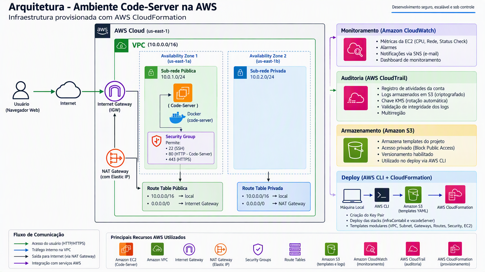
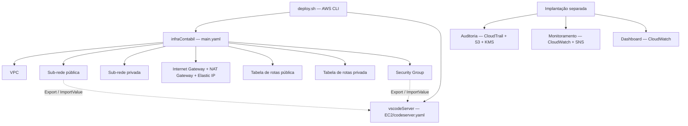

# Infraestrutura AWS — Ambiente de desenvolvimento Code-Server | UPSK

## Integrantes do grupo

- José Wellington Alves Rocha Júnior
- Eduardo Prado Takitani
- Matheus Vinicius Queiroz Alves
- Guilherme Roberto Alves Shiga
- Paulo Felipe de Araujo Junior

Projeto educacional de infraestrutura para uma startup fictícia, desenvolvido no contexto de Upskilling para aplicar conceitos de **Infrastructure as Code (IaC)**, redes, computação, auditoria e monitoramento na AWS.

A solução disponibiliza um ambiente de programação acessível pelo navegador usando **Code-Server em Docker sobre Amazon EC2**, com infraestrutura definida em **AWS CloudFormation** e implantação automatizada por **AWS CLI**.

> **Escopo e segurança:** o estado atual é uma demonstração, não uma configuração pronta para produção. A instância está em uma sub-rede pública, o serviço é publicado em HTTP e existe uma senha fixa no template. Revise a seção [Segurança, limitações e melhorias](#segurança-limitações-e-melhorias) antes de implantar ou expor o ambiente.

## Sumário

- [Objetivo e proposta de valor](#objetivo-e-proposta-de-valor)
- [Arquitetura](#arquitetura)
- [Estrutura do projeto](#estrutura-do-projeto)
- [Recursos e configurações](#recursos-e-configurações)
- [Pré-requisitos](#pré-requisitos)
- [Implantação](#implantação)
- [Acesso e verificação](#acesso-e-verificação)
- [Auditoria e monitoramento opcionais](#auditoria-e-monitoramento-opcionais)
- [Segurança, limitações e melhorias](#segurança-limitações-e-melhorias)
- [Backup e recuperação](#backup-e-recuperação)
- [Custos e operação](#custos-e-operação)
- [Desativação do ambiente](#desativação-do-ambiente)
- [Checklist de entrega](#checklist-de-entrega)
- [Documentação de apoio](#documentação-de-apoio)

## Objetivo e proposta de valor

Disponibilizar um ambiente de desenvolvimento web padronizado para empregados, reduzindo a necessidade de instalar e manter ferramentas em cada estação de trabalho.

Para um cliente ou gestor, os principais benefícios são:

- **Agilidade:** acesso ao editor pelo navegador e provisionamento repetível por templates.
- **Padronização:** configuração centralizada do servidor e execução da aplicação em contêiner.
- **Gestão:** recursos identificados por tags e infraestrutura organizada em módulos reutilizáveis.
- **Visibilidade operacional:** templates adicionais para alarmes, notificações e dashboard.
- **Rastreabilidade:** template de auditoria com CloudTrail e armazenamento criptografado dos registros.

Esses benefícios dependem da implantação e validação dos respectivos módulos. Isolamento por usuário, autenticação corporativa, HTTPS e backup da aplicação ainda precisam ser implementados para um uso corporativo seguro.

## Arquitetura

### Visão geral



> O diagrama representa a visão geral da solução. As zonas são selecionadas por índice nos templates, não por nomes fixos. HTTPS não está configurado na aplicação; proteção e versionamento do bucket de templates dependem de configuração externa. O bucket de auditoria, por sua vez, possui essas proteções no template.

### Organização das stacks

O padrão adotado para a **rede** é o de **nested stacks**: [main.yaml](main.yaml) orquestra sete stacks filhas, reutilizando os módulos de sub-rede e de tabelas de rotas.



A stack da EC2 é **independente**, não uma nested stack da rede. Ela depende dos valores exportados pela infraestrutura. Os três templates de [Extras](Extras) também são independentes e **não são executados pelo script de implantação**.

### Rede e fluxo de comunicação

| Componente | Configuração atual |
| --- | --- |
| Região do script | `us-east-1` |
| VPC | `10.0.0.0/16`, com suporte a DNS e hostnames habilitado |
| Sub-rede pública | `10.0.1.0/24`, primeira AZ retornada por `Fn::GetAZs`, IP público automático |
| Sub-rede privada | `10.0.2.0/24`, segunda AZ retornada por `Fn::GetAZs`, sem IP público automático |
| Rota pública | `0.0.0.0/0` → Internet Gateway |
| Rota privada | `0.0.0.0/0` → NAT Gateway na sub-rede pública |
| Aplicação | Uma instância EC2 na sub-rede pública |

1. O usuário acessa o IP ou DNS público da EC2 pelo navegador.
2. A conectividade da sub-rede pública utiliza o Internet Gateway e sua tabela de rotas.
3. O Security Group permite ou bloqueia a conexão conforme protocolo, porta e origem.
4. A porta `80` da EC2 é encaminhada à porta `8443` do contêiner Code-Server.
5. A EC2 acessa serviços externos, como repositórios Git e atualizações, pelo Internet Gateway.
6. Recursos que venham a ser criados na sub-rede privada poderão iniciar conexões IPv4 com a internet pelo NAT Gateway, sem exposição direta de entrada por esse mecanismo.

A sub-rede privada não contém aplicações neste projeto. As duas sub-redes em AZs distintas **não tornam a aplicação altamente disponível**: há apenas uma EC2 e um NAT Gateway.

## Estrutura do projeto

| Arquivo | Responsabilidade |
| --- | --- |
| [main.yaml](main.yaml) | Orquestração das nested stacks de rede e outputs consolidados |
| [deploy.sh](deploy.sh) | Criação/verificação do Key Pair e implantação sequencial de rede e EC2 |
| [modules/vpc.yaml](modules/vpc.yaml) | VPC, DNS e exportação do identificador da VPC |
| [modules/subnet.yaml](modules/subnet.yaml) | Sub-rede reutilizável com CIDR, AZ e IP público parametrizados |
| [modules/gateways.yaml](modules/gateways.yaml) | Internet Gateway, associação à VPC, Elastic IP e NAT Gateway |
| [modules/routeTables.yaml](modules/routeTables.yaml) | Tabela de rotas, rota padrão condicional e associação à sub-rede |
| [modules/security.yaml](modules/security.yaml) | Security Group para SSH, HTTP e HTTPS |
| [EC2/codeserver.yaml](EC2/codeserver.yaml) | EC2 Ubuntu e instalação do Code-Server em Docker via User Data |
| [Extras/auditoria-cloudtrail.yaml](Extras/auditoria-cloudtrail.yaml) | CloudTrail multirregião, bucket S3 de logs e chave KMS |
| [Extras/monitoramento-cloudwatch.yaml](Extras/monitoramento-cloudwatch.yaml) | Alarmes de CPU, status e rede com notificações SNS por e-mail |
| [Extras/dashboard.yaml](Extras/dashboard.yaml) | Dashboard CloudWatch com widget opcional de alarme |
| [Arquitetura.png](Arquitetura.png) | Diagrama da solução |
| [relatorio_infra_aws_Grupo_suporte.docx](relatorio_infra_aws_Grupo_suporte.docx) | Relatório de infraestrutura, governança, riscos e entrega |
| [Projeto.zip](Projeto.zip) | Pacote dos templates e script, idênticos aos arquivos atuais na revisão desta documentação |

## Recursos e configurações

### Infraestrutura de rede

Parâmetros da stack principal:

| Parâmetro | Padrão | Observação |
| --- | --- | --- |
| `BucketS3` | Sem padrão | Apesar do nome, recebe o prefixo do endpoint, por exemplo `meu-bucket.s3.us-east-1`, pois o template acrescenta `.amazonaws.com` |
| `NameVPC` | `CodeServer` | O script passa `codeserver`; a tag da VPC recebe o sufixo `-VPC` |
| `cidrBlockSubPub` | `10.0.1.0/24` | CIDR da sub-rede pública |
| `cidrBlockSubPrivate` | `10.0.2.0/24` | CIDR da sub-rede privada |

No módulo da VPC, `CidrVPCBus` possui padrão `16`, formando `10.0.0.0/16`; esse parâmetro não é repassado pela stack principal. Os CIDRs devem permanecer compatíveis com a VPC e não podem se sobrepor.

Os outputs da stack principal são `VpcId`, `SubnetPubId`, `SubnetPrivId`, `InternetGatewayId`, `NatEIPId`, `NatGatewayId` e `WebSecurityGroupId`. `NatEIPId` retorna o valor de `Ref` do Elastic IP, isto é, o endereço IP, não o Allocation ID.

### Servidor e contêiner

| Item | Configuração |
| --- | --- |
| Tipo da EC2 | `t3.medium` por padrão; também aceita `t2.medium`, `t3.micro` e `t3.small` |
| Sistema operacional | Ubuntu Server 24.04 AMD64; AMI resolvida pelo parâmetro público SSM da Canonical na região |
| Key Pair | Parâmetro obrigatório `KeyName`; o script usa `code-server` |
| Nome da instância | `NomeInstancia` + `-EC2`; o script usa `codeserver2-EC2` |
| Pacotes instalados | `docker.io`, `git`, `htop` e `micro` |
| Imagem do contêiner | `lscr.io/linuxserver/code-server:latest` |
| Publicação | Porta `80` do host → `8443` do contêiner; sem TLS configurado pelo projeto |
| Configuração persistente | Volume Docker `vscode-config` montado em `/config` |
| Workspace padrão | `/config/workspace` |
| Montagem adicional | Diretório corrente do User Data montado em `/home/coder/project` |
| Fuso horário | `America/Sao_Paulo` |
| Reinício | `unless-stopped`; serviço Docker habilitado na inicialização |

O template define `PUID=1000` e `PGID=1000`, mas também passa `--user` com o usuário que executa o User Data, normalmente root. Essa combinação deve ser revisada antes de assumir execução sem privilégios.

As configurações persistem localmente no disco da EC2; o volume Docker **não é um backup** nem um armazenamento independente da instância.

### Dependências entre stacks

A EC2 importa `CodeServer-CodeServerSubPub` e `CodeServer-WebSG`. Os módulos também exportam `UPSK-VPC` e `CodeServer-CodeServerSubPrivada`.

As stacks precisam estar na **mesma conta e região** para utilizar esses imports. Os nomes fixos dos exports dificultam implantar múltiplos ambientes na mesma conta/região e impedem remover exports enquanto outra stack os utiliza.

## Pré-requisitos

- Conta AWS e credenciais configuradas na AWS CLI, preferencialmente com credenciais temporárias/SSO.
- Permissões para CloudFormation, S3, EC2/VPC e consulta ao parâmetro público SSM da AMI; para extras, permissões adicionais de CloudTrail, KMS, CloudWatch e SNS.
- Bash em Linux, macOS, WSL ou AWS CloudShell. O script utiliza `/tmp`, `${HOME}` e `chmod`; não foi escrito para PowerShell nativo.
- Bucket S3 de templates previamente criado, com nome globalmente único e acessível pelo CloudFormation. Para este fluxo, utilize a mesma região das stacks.
- Disponibilidade de pelo menos duas AZs na região, cotas para EC2, VPC, NAT Gateway e Elastic IP, e autorização para os custos associados.
- Conectividade externa da EC2 para obter pacotes e baixar a imagem do contêiner.

O projeto não provisiona o bucket de templates nem usuários, grupos, políticas IAM ou perfis de instância. Essas configurações são pré-requisitos externos, não recursos já implementados aqui.

## Implantação

> Os comandos abaixo são para **Bash** e devem ser executados na raiz do projeto. A implantação cria recursos faturáveis. Faça primeiro os ajustes de segurança descritos neste documento.

### 1. Revisar a configuração

Em [deploy.sh](deploy.sh), ajuste `REGION` e `BUCKET` para sua conta. O bucket atualmente configurado é específico do exemplo e não deve ser presumido disponível.

O script utiliza os nomes de stack `infraContabil` e `vscodeServer`. Também define o modelo `t3.medium` e o nome de instância `codeserver2`. A variável `BASE` existe no script, mas não é utilizada.

Antes de enviar os templates, revise a senha do contêiner e restrinja as origens permitidas no Security Group. Alterações locais só chegam ao deploy após novo envio ao S3.

### 2. Confirmar a identidade e publicar os templates

```bash
aws sts get-caller-identity

REGION="us-east-1"
BUCKET="substitua-pelo-seu-bucket"

aws s3 cp . "s3://${BUCKET}/" \
   --recursive \
   --exclude "*" \
   --include "*.yaml" \
   --region "${REGION}"
```

Mantenha a estrutura de diretórios no bucket: a stack principal referencia os módulos em `modules/`, e o script baixa o template da EC2 de `EC2/`. O comando publica apenas os YAMLs, sem enviar chave privada, relatório ou demais arquivos.

Mantenha o bucket privado, configure acesso adequado para a identidade de implantação/CloudFormation e considere versionamento e criptografia. **Não é necessário tornar os templates públicos.** Essas proteções do bucket de templates não são criadas pelo projeto.

### 3. Executar o script

```bash
bash deploy.sh
```

O script:

1. Verifica se o Key Pair `code-server` existe na região.
2. Se necessário, cria uma chave RSA, salva a chave privada em `${HOME}/code-server.pem` e aplica permissão `400`.
3. Se o Key Pair já existir, apenas verifica o arquivo local e emite um aviso caso ele não exista. A AWS não permite recuperar novamente a chave privada.
4. Baixa o template principal do S3 para `/tmp/infraContabil-template.yaml` e implanta a rede.
5. Após a conclusão da rede, baixa o template da EC2 para `/tmp/vscodeServer-template.yaml` e implanta o servidor.

O script usa `set -e` para interromper em caso de erro de comando. Ele **não cria o bucket, não publica arquivos no S3 e não implanta os extras**. A ausência de uma chave privada local existente gera aviso, mas não impede a implantação.

> `CREATE_COMPLETE` da EC2 não garante que o Code-Server esteja pronto: não há `CreationPolicy` ou sinalização de conclusão do User Data. Aguarde a instalação e verifique os logs.

## Acesso e verificação

Consulte os endereços gerados:

```bash
aws cloudformation describe-stacks \
   --stack-name vscodeServer \
   --region us-east-1 \
   --query 'Stacks[0].Outputs' \
   --output table
```

- **Aplicação:** use `http://<PublicIp>` ou `http://<PublicDns>` no navegador. A senha é a definida em `PASSWORD` no User Data; o valor fixo original é inseguro e deve ser substituído antes da implantação.
- **Administração:** utilize SSH com o usuário `ubuntu`, a chave privada correspondente e uma origem autorizada no Security Group.
- **HTTPS:** a liberação da porta `443` no Security Group não configura certificado, proxy reverso ou listener HTTPS.

Para diagnosticar falhas, consulte os eventos das stacks no CloudFormation. Na EC2, verifique o log de inicialização em `/var/log/cloud-init-output.log`, o estado do Docker e os logs do contêiner `code-server`.

Checklist funcional após a implantação:

- [ ] Stacks de rede e EC2 concluídas sem falhas.
- [ ] Instância com verificações de status aprovadas e IP público atribuído.
- [ ] Instalação do User Data concluída e contêiner em execução.
- [ ] Interface do Code-Server acessível apenas pelas origens autorizadas.
- [ ] Workspace e persistência local testados.

## Auditoria e monitoramento opcionais

Esses módulos precisam de implantação separada. Os nomes de stack abaixo são sugestões para operação; não estão definidos no script principal.

### Auditoria — AWS CloudTrail

O template [Extras/auditoria-cloudtrail.yaml](Extras/auditoria-cloudtrail.yaml) cria:

- Trail multirregião ativo, incluindo eventos globais e eventos de gerenciamento de leitura e escrita.
- Bucket S3 de logs com versionamento, bloqueio de acesso público e criptografia SSE-KMS com S3 Bucket Key.
- Chave KMS com rotação automática e alias associado ao nome da trilha.
- Política de bucket permitindo a entrega pelo CloudTrail e negando transporte sem TLS.
- Validação de integridade dos arquivos habilitada por padrão.

Parâmetros: `TrailName` (padrão `infra-cloudtrail`) e `EnableLogFileValidation` (padrão `true`). Os outputs identificam trilha, bucket, chave e alias KMS.

```bash
aws cloudformation deploy \
   --stack-name codeserver-auditoria \
   --template-file Extras/auditoria-cloudtrail.yaml \
   --region us-east-1
```

Não há seleção de eventos de dados do S3, envio para CloudWatch Logs, política de ciclo de vida/retenção ou `DeletionPolicy: Retain`. Validação de integridade e versionamento não equivalem a imutabilidade por Object Lock. Valide a entrega efetiva dos logs após a criação.

### Monitoramento — Amazon CloudWatch e SNS

O template [Extras/monitoramento-cloudwatch.yaml](Extras/monitoramento-cloudwatch.yaml) utiliza métricas nativas do EC2 e consultas Metrics Insights, sem instalar CloudWatch Agent ou adicionar IAM Role à instância.

| Alarme | Consulta/limiar padrão | Avaliação |
| --- | --- | --- |
| CPU elevada | `MAX(CPUUtilization)` ≥ 80% | 2 de 2 períodos de 300 segundos |
| Falha de status | `MAX(StatusCheckFailed)` ≥ 1 | 2 de 2 períodos de 60 segundos |
| Rede de entrada | `MAX(NetworkIn)` > 1 GiB | 2 de 3 períodos de 300 segundos |
| Rede de saída | `MAX(NetworkOut)` > 1 GiB | 2 de 3 períodos de 300 segundos |

`Environment` tem padrão `production`. `CPUThreshold`, `NetworkInThreshold` e `NetworkOutThreshold` são ajustáveis; `NotificationEmail` é obrigatório. CPU e status enviam notificações de alarme e recuperação; os alarmes de rede notificam apenas a entrada em estado de alarme.

```bash
aws cloudformation deploy \
   --stack-name codeserver-monitoramento \
   --template-file Extras/monitoramento-cloudwatch.yaml \
   --region us-east-1 \
   --parameter-overrides \
      Environment=dev \
      NotificationEmail=seu-email@exemplo.com
```

**Confirme a assinatura pelo e-mail enviado pelo SNS.** Sem essa confirmação, as notificações não serão entregues.

As consultas não filtram tags nem `InstanceId`: o parâmetro `Environment` apenas nomeia e identifica recursos, não restringe as EC2 monitoradas. Os limiares de rede usam `MAX`, não a soma do tráfego no período; valide a semântica e ajuste caso o objetivo seja medir volume total. Memória, uso de filesystem e logs da aplicação não são coletados por este template.

### Dashboard — Amazon CloudWatch

O template [Extras/dashboard.yaml](Extras/dashboard.yaml) define widgets de CPU, status, rede, uma referência a `AWS/CloudTrail / ApiCallCount` e outra a `AWS/Usage / CallCount`. Aceita `Environment` (padrão `dev`) e `EC2AlarmArn` (opcional). Quando o ARN é informado, inclui um widget de alarme.

```bash
aws cloudformation deploy \
   --stack-name codeserver-dashboard \
   --template-file Extras/dashboard.yaml \
   --region us-east-1 \
   --parameter-overrides Environment=dev
```

O output `SecurityDashboardURL` fornece o link do painel. Para exibir um alarme, forneça seu ARN completo em `EC2AlarmArn`; o template de monitoramento exporta nomes de alarmes nos outputs, não seus ARNs.

> **Validação necessária:** os widgets EC2 não especificam `InstanceId` nem consultas de agregação. Criar o painel não garante que esses gráficos exibam dados. A trilha configurada também não habilita explicitamente a métrica `ApiCallCount` referenciada pelo dashboard; revise a disponibilidade e as dimensões de cada métrica. O painel não consulta diretamente os arquivos de logs armazenados no S3.

## Segurança, limitações e melhorias

O relatório apresenta objetivos e práticas de governança, alguns de forma condicional. A tabela abaixo distingue o que está nos templates do que ainda depende de configuração externa ou evolução.

| Tema | Estado atual | Ação recomendada |
| --- | --- | --- |
| Segmentação | VPC dedicada, sub-rede pública e privada; EC2 na pública | Avaliar aplicação privada e acesso corporativo controlado |
| Regras de entrada | TCP `22`, `80` e `443` abertas para `0.0.0.0/0` | Restringir a IPs/redes autorizados e remover portas não utilizadas |
| Regras de saída | Todo tráfego IPv4 permitido | Revisar destinos e necessidades da aplicação |
| Firewall | Security Group stateful | Não confundir com AWS Network Firewall ou WAF, que não são criados |
| Criptografia em trânsito | Porta 80 publicada; sem configuração TLS | Implementar HTTPS com certificado e proxy reverso ou balanceador adequado |
| Segredos | Senha fixa em texto no User Data e variável do contêiner | Remover segredo do código e integrar gestão segura; trocar a senha já exposta |
| IAM | Sem usuários, políticas ou perfil de instância provisionados | Definir menor privilégio para implantação e operação |
| Disco da EC2 | Sem configuração explícita de criptografia EBS no template | Configurar e verificar criptografia; padrões da conta não são garantidos pelo código |
| S3 de templates | Bucket externo não criado pelo projeto | Verificar Block Public Access, políticas, criptografia e versionamento |
| S3 de auditoria | Proteções, versionamento e SSE-KMS definidos no extra | Definir retenção, acesso de investigação e proteção contra exclusão |
| Contêiner | Imagem `latest` e usuário herdado do User Data via `--user` | Fixar versão/digest e revisar privilégios e permissões dos volumes |
| Multiusuário | Uma instância/contêiner com senha compartilhada | Definir autenticação, autorização e isolamento de workspaces |
| Disponibilidade | Uma EC2 e um NAT Gateway | Planejar recuperação e alta disponibilidade conforme requisitos |
| Observabilidade | Extras disponíveis, mas fora do deploy principal | Implantar, confirmar SNS e testar métricas, alarmes e entrega de logs |
| Custos | Sem AWS Budgets ou alertas financeiros provisionados | Configurar orçamento, tags de custos e acompanhamento financeiro |

## Backup e recuperação

A estratégia atual permite **recriar a infraestrutura** pelos templates, mas **não restaura automaticamente os dados de desenvolvimento**.

- O volume Docker reside no armazenamento local da EC2. Não existe política de snapshots EBS, AWS Backup ou cópia externa dos workspaces.
- O versionamento do bucket de auditoria protege versões de objetos de logs, não os arquivos do Code-Server.
- Os templates não configuram retenção dos dados da EC2 na exclusão da stack nem um fluxo automático de restauração.
- RPO, RTO, retenção e testes de restauração ainda não estão definidos ou evidenciados no projeto.

Para evoluir a recuperação: versionar código em repositório remoto, definir backup dos workspaces e configurações, automatizar snapshots/backup com retenção, proteger logs e chaves e testar a restauração em um ambiente isolado.

## Custos e operação

Os principais componentes que podem gerar cobrança são:

- EC2, armazenamento EBS e endereço IPv4 público.
- NAT Gateway por tempo provisionado e dados processados, além do IPv4 associado. **Parar a EC2 não elimina o custo do NAT Gateway.**
- Transferência de dados, inclusive entre AZs quando recursos privados utilizarem o NAT da outra AZ.
- S3 para templates e logs, solicitações e armazenamento de versões.
- Chave KMS e operações criptográficas.
- CloudWatch, consultas, alarmes e dashboard; SNS e CloudTrail conforme uso, modalidade de eventos e trilhas existentes.

Não há estimativa financeira fixa nem garantia de gratuidade. Consulte a precificação da região e o AWS Pricing Calculator antes de implantar; trilhas adicionais podem gerar custos extras. Os alarmes de rede **não são alertas de faturamento**.

Na rotina operacional, acompanhe eventos das stacks, status da EC2, contêiner, capacidade do disco, entrega dos logs de auditoria, estado dos alarmes e confirmação da assinatura SNS. Revise acessos, atualizações e dimensionamento periodicamente. As tags existentes ajudam a identificar recursos, mas a cobertura não é uniforme e a alocação de custos exige configuração na conta.

## Desativação do ambiente

Antes da exclusão, salve os dados necessários e defina a retenção dos registros de auditoria. A remoção da EC2 pode eliminar os arquivos do workspace e o volume Docker.

Exclua primeiro a stack da aplicação e aguarde sua remoção antes de excluir a rede, pois ela utiliza exports das nested stacks:

```bash
aws cloudformation delete-stack --stack-name vscodeServer --region us-east-1
aws cloudformation wait stack-delete-complete --stack-name vscodeServer --region us-east-1

aws cloudformation delete-stack --stack-name infraContabil --region us-east-1
aws cloudformation wait stack-delete-complete --stack-name infraContabil --region us-east-1
```

- Remova separadamente as stacks de monitoramento e dashboard, se foram implantadas e não serão mais utilizadas.
- Para a auditoria, planeje a preservação dos logs e da chave KMS **antes** de excluir a stack. O bucket versionado não vazio pode impedir a exclusão; excluir objetos atuais não remove versões anteriores e marcadores de exclusão.
- O template de auditoria não declara `Retain`. A exclusão da chave KMS pode tornar os logs irrecuperáveis após o período de espera aplicável. Não esvazie o bucket nem remova a chave sem autorização e política de retenção definida.
- O bucket de templates, o Key Pair e a chave privada local são externos às stacks e não são removidos por essas operações.
- Confira no console se não restaram recursos faturáveis após falhas ou exclusões parciais, especialmente NAT Gateway, EIPs, volumes e recursos de observabilidade.


## Documentação de apoio

- [Relatório de infraestrutura do grupo de suporte](relatorio_infra_aws_Grupo_suporte.docx): finalidade, inventário, arquitetura, governança, recuperação, custos e riscos. Há campos em branco e controles condicionais que devem ser preenchidos com evidências reais.
- [Diagrama de arquitetura](Arquitetura.png): visão visual do ambiente e das integrações previstas.
- [Pacote do projeto](Projeto.zip): cópia dos templates e do script; deve ser atualizado separadamente quando esses arquivos forem alterados.

**Base desta documentação:** leitura dos arquivos locais, do relatório e do diagrama. Não foram executados deploy, validação remota de templates ou testes funcionais na AWS durante esta revisão.
